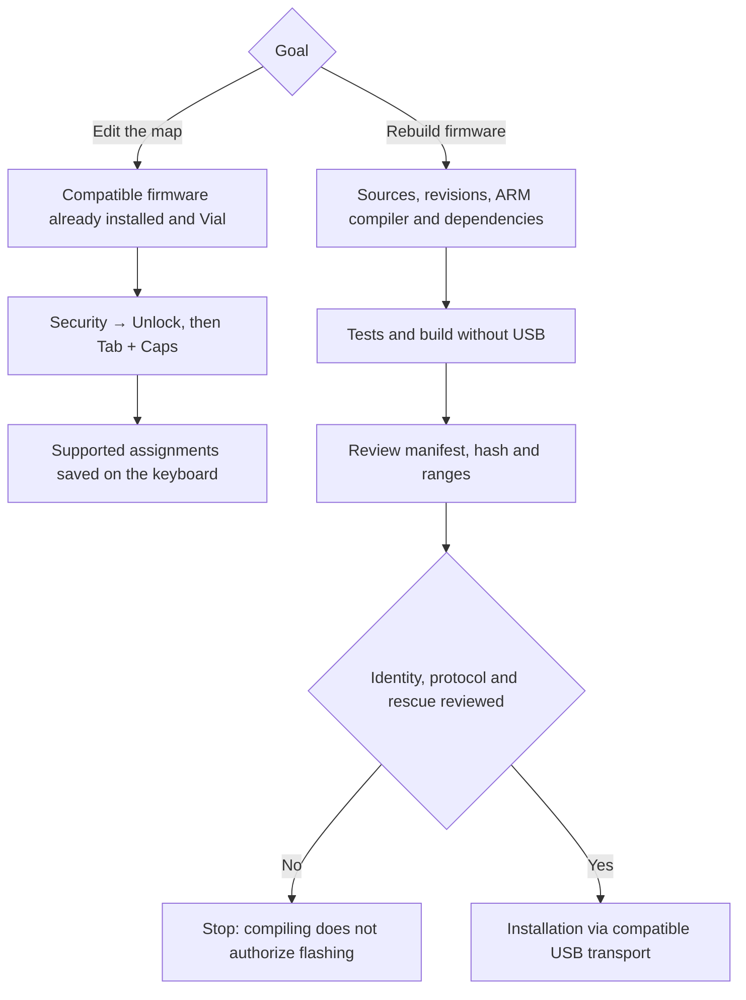

# HyperX Alloy FPS Pro — QMK firmware with Vial configuration

Independent experimental port for the **HyperX Alloy FPS Pro HX-KB4RD1-US**,
TKL ANSI. Uses the original controller: no PC remapper or external adapter.
Based on SonixQMK, with a custom subset of the Vial protocol.

> [!WARNING]
> **Use at your own risk. A first installation may leave the keyboard
> unusable. Success on this unit does NOT guarantee compatibility with
> another, even if it shares the same name or SKU.**
>
> **There is no OEM backup of this unit and no verified procedure to
> restore it to factory firmware exactly.** The analyzed reference image
> is not that backup. An Escape rescue entry was installed and tested,
> but **rescue does not mean backup or a guarantee against any brick**.
> If that entry is lost, there is no validated recovery within the
> constraint of keeping the case closed. Read [risks and recovery](docs/safety-and-recovery.md)
> before considering any write. No stable release has been declared.

## Why this was done

On the author's unit, five keys stopped working: `8 9 0 - =`.
The decision was made to reuse the healthy positions with layers and a
configurable firmware, approximating a ~42-key workflow. **Rewriting the
firmware did not repair the keys nor physically diagnose the cause**: no
continuity was checked and the case was not opened. The goal is to make
use of the rest, not to promise fixing traces, switches, or diodes through
software.

## Current state

Updated: **2026-10-30**. Results on one unit — not a certification for all
revisions of this model.

| Result | Evidence and scope |
| --- | --- |
| Firmware installed and keyboard functional | Human typing confirmed; full matrix and long-term stability not certified. |
| Full TKL in Vial | 87 positions drawn; 82 usable and five broken (`8 9 0 - =`) still disabled. |
| Vial desktop and web | Detection confirmed; the USB marker required for desktop discovery was corrected. |
| Four layers and persistent editing | Changes from GUI, full map read before/after reconnecting, and physical output confirmed. |
| Test map restored | All four layers match the initial map again; no leftover E keys from the test. |
| Scoped USB update | Scoped ISP transport and app-only write tested, preserving bootloader and map ranges. ACK/echo are not a full flash readback. |
| Escape → ISP | Verified on connect with app Bootmagic disabled; a deliberately corrupt app was not tested. |

**This is not full Vial-QMK.** No lighting, macros, combos, tap-dance,
one-shot, multimedia/volume, mouse keys, or QMK Settings are configurable
in this variant. The five broken positions were not repaired by firmware.

## Real view in Vial


Screenshot provided by the user in Vial 0.7.5. The upper keyboard shows
**87 physical positions and 82 usable ones**. The five empty slots between
7 and Backspace are `8 9 0 - =`, kept as `KC_NO` due to their fault; **they
are not missing from the drawing**. Vial's lower palette offers more functions
than this firmware supports: their appearance in the interface does not mean
they are implemented.

## Before editing: unlock

> [!IMPORTANT]
> **If a key doesn't change or the change doesn't save, check the unlock step first.
> Do not reflash to resolve a simply locked keyboard.**
>
> In this variant you must unlock **once per connection, before editing**.
> Disconnecting, restarting, or choosing Lock re-locks writes, but
> **does not erase the map or prevent using it**. You don't need to repeat
> it for every key assignment.

1. Open **a single** Vial client and select the HyperX.
2. From the Vial menu, choose **Security → Unlock**. If the menu is not
   in the window, look for it in the system menu bar.
3. Hold **Tab + Caps Lock physically** until the bar completes; then release.
   Pressing them without starting Unlock does nothing. In the reference GUI
   this takes about 4 s.
4. Select the target layer and key in the upper drawing; choose its new
   assignment with the mouse in the lower selector.
5. Each supported assignment saves automatically. There is no final save,
   no C recompilation, and no need to keep Vial open to use the map.

`▽` / `KC_TRNS` inherits from the layer below; it is **not** `KC_NO`/Disabled.
The base Fn activates layer 1 while held (`MO(1)`). See [usage and diagnostics](docs/usage.md).

## Escape on connect: only for update or rescue

| Action | Purpose | When to use |
| --- | --- | --- |
| Connect without Escape | Normal firmware boot. | Daily use and opening Vial. |
| Security → Unlock then Tab+Caps | Authorize map writes in Vial. | Once per connection before editing. Does not change the application firmware. |
| Hold Escape while connecting USB | Enter ISP before the application runs. | Reviewed firmware update or diagnosis/rescue if the app doesn't boot. **Not** for normal key editing. |

In ISP the keyboard is not in normal use and does not offer its Vial configurator.
Entry is verified by metadata/queries; during tests, indicate when to release Escape.
Programming is never started just by connecting with Escape.
If entered accidentally **and no write is in progress**, reconnecting without
Escape allows attempting normal boot. **Never disconnect during programming.**
See [procedure and limits](docs/safety-and-recovery.md).

## Model and scope

- Unit: **Alloy FPS Pro HX-KB4RD1-US**. Not the full-size Alloy FPS or
  Alloy Origins Core; their binaries are not interchangeable.
- OEM observed: `0951:16d2`, `bcdDevice=2112`. Those fields alone do not
  identify a PCB or prove byte-for-byte firmware identity.
- ISP observed: family **SN32F26x**, CS0. `SN32F268F/FG` is the port
  candidate, **not a package physically verified on this unit**.
- Matrix inferred as 14×8; 87 physical positions, 82 offered in the editable.
- Case closed throughout the project. The physical Silakka54 was not accessed;
  only the public reference offered was used to understand the workflow.

## Where to start

| Need | Document |
| --- | --- |
| Understand what works, what's missing, memory and possible improvements | [Status and limits](docs/status-and-limits.md) |
| Use Vial, unlock, and diagnose changes that don't save | [Daily use](docs/usage.md) |
| Risks, what NOT to do, and differences between rescue and backup | [Safety and recovery](docs/safety-and-recovery.md) |
| Machines, compilers, dependencies, and reproduction | [Prerequisites and reproduction](docs/reproduction.md) |
| Understand how conclusions were reached | [Process and decisions](docs/process-and-decisions.md) |
| Update an already-installed unit, with scoped range | [USB transports](docs/usb-update.md) |
| Resume the project and prioritize pending work | [Continuation](docs/next-steps.md) |
| Consult hardware evidence and timeline | [Evidence](hardware/first-flash-evidence.json), [log](docs/project-log.md) |
| Understand sources, maps, and experiments | [Firmware](firmware/README.md) |

## What you need to do



Compilation requires a toolchain-compatible environment; installation requires
a USB backend implemented for the platform being used. Universal support is
not promised. The [reconstruction record](toolchains/reconstruction-record.json)
identifies sources, dependencies, hashes, and memory of the tested candidate.

## Benefits and costs

**Benefits:** reuse the keyboard without additional electronics, remap and
organize layers from Vial, retain them without resident software, and have
sources, revisions, and tests documented. A ~42-key zone can be used without
losing the other healthy positions.

**Costs and risks:** replaces OEM behavior, loses its backlight with this port,
does not have all Vial functions, and works with only 2 KB of RAM in the
platform model. There is a brick risk with no verified OEM return; a different
revision needs its own validation. Repairing keys, unlimited flash lifetime,
or full stability are not promised. See [the detailed analysis](docs/status-and-limits.md).

## Repository layout

```text
firmware/    C/ASM port, jumploader, keymaps and experiments
scripts/     Generation, build, measurement and scoped USB tools
tests/       Host tests, failure simulation and tool validations
hardware/    Inferred matrix and sanitized public evidence, with explicit scope
toolchains/  Fixed revisions and sources for compilation/protocol
docs/        Current guides, decisions, timeline and historical reports
```

Two machines or two operating systems are not required. The flow separates
configuration, compilation, and installation: one machine with compatible tools
and transport can cover all of it. See [actual requirements and compatibility](docs/reproduction.md);
do not confuse the trial environments with an obligation to use them together.
Tests/builds must not be confused with flashing.

## Preserved research

These documents are dated background material, not the current state:
[identification](docs/hardware-identification.md),
[extraction and matrix](docs/closed-case-development.md),
[first ARM build](docs/arm-build-and-boot.md),
[USB and startup](docs/usb-isp-and-startup.md),
[first trial](docs/first-flash-trial.md),
[Vial budget](docs/vial-memory-budget.md),
[read prototype](docs/vial-readonly-prototype.md),
[simulated store](docs/vial-map-store.md),
[initial feasibility](docs/initial-feasibility-history.md).
They are kept to reconstruct the reasoning and its sources; they are not
deleted just because a later test superseded them.

## Publication, backup, and license

GitHub backs up **what is versioned**, not the keyboard's OEM firmware.
`build/`, `artifacts/`, updater/DLL, tools, binaries, photos, and private
map snapshots are excluded. No credentials or label identifiers are published.
See [publication review](docs/publication-review.md).

SPDX headers in sources are preserved. **The global license and attribution
review are still pending**; publishing the process does not imply permission
to redistribute proprietary firmware or a manufacturer warranty.
Independent project, with no official affiliation with HyperX, SONiX, QMK, or Vial.
