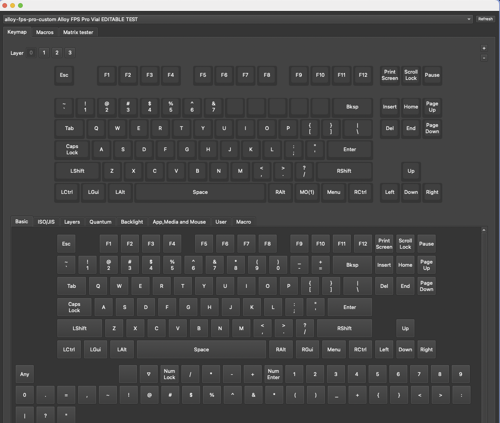
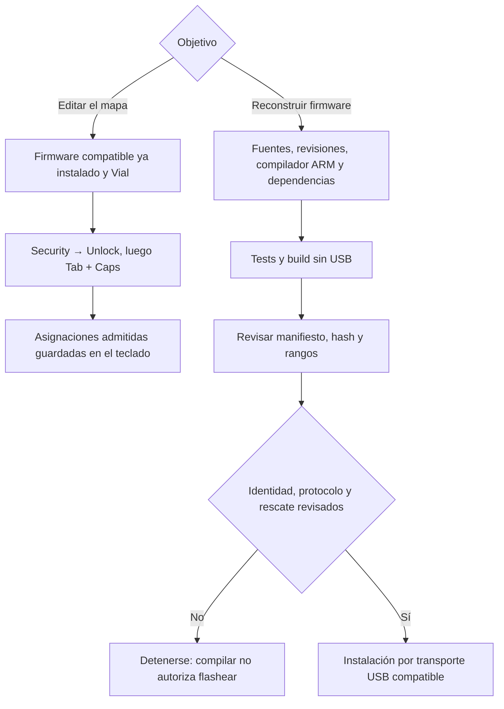

[🇬🇧 Read in English](README.en.md)

# HyperX Alloy FPS Pro — firmware QMK con configuración Vial

Port experimental independiente para **HyperX Alloy FPS Pro HX-KB4RD1-US**,
TKL ANSI. Conserva el controlador original: no usa un remapeador del PC ni un
adaptador externo. Basado en SonixQMK, con un subconjunto propio del protocolo Vial.

> [!WARNING]
> **Uso bajo tu propia responsabilidad. Una primera instalación puede dejar el
> teclado inutilizable. El éxito en esta unidad NO garantiza compatibilidad con
> otra, aunque tenga el mismo nombre o SKU.**
>
> **No hay un backup OEM de la unidad ensayada ni un procedimiento comprobado para
> devolverla exactamente al firmware de fábrica.** La imagen de referencia
> analizada no es ese backup. Se instaló y probó una entrada de rescate por Escape,
> pero **rescate no significa backup ni garantía contra cualquier bloqueo**.
> Si se pierde esa entrada, no hay una recuperación validada dentro del límite
> de mantener la carcasa cerrada. Leer [riesgos y recuperación](docs/safety-and-recovery.md)
> antes de considerar cualquier escritura. No hay una release declarada estable.

## Por qué se hizo

En la unidad ensayada dejaron de funcionar cinco teclas: `8 9 0 - =`.
Se decidió reutilizar las posiciones sanas con capas y un firmware configurable,
acercando el flujo a una zona de unas 42 teclas. **Reescribir el firmware no
reparó las teclas ni diagnosticó físicamente la causa**: no se comprobó continuidad
ni se abrió la carcasa. La finalidad es aprovechar el resto, no prometer arreglar
pistas, switches o diodos mediante software.

## Estado actual

Resultados de hardware al **2026-10-30**; revisión documental **2026-10-31**.
Pruebas sobre una unidad, no certificación de todas las revisiones del modelo.

| Resultado | Evidencia y límite |
| --- | --- |
| Firmware instalado y teclado funcional | Escritura humana confirmada; matriz completa y estabilidad prolongada no certificadas. |
| TKL completo en Vial | 87 posiciones dibujadas; 82 útiles y cinco averiadas (`8 9 0 - =`) todavía deshabilitadas. |
| Vial de escritorio y web | Detección confirmada; se corrigió la marca USB necesaria para descubrirlo en escritorio. |
| Cuatro capas y edición persistente | Cambios desde GUI, lectura completa del mapa antes/después de reconectar y salida física confirmadas. |
| Mapa de prueba restaurado | Las cuatro capas coinciden otra vez con el mapa inicial; no quedaron las tres E de la prueba. |
| Actualización USB acotada | Transporte ISP acotado y app-only probado, preservando los rangos de arranque y mapas. ACK/eco no son lectura completa de flash. |
| Escape → ISP | Comprobado al conectar con Bootmagic de la app deshabilitado; no se probó una app deliberadamente corrupta. |

**No es Vial-QMK completo.** No hay iluminación, macros, combos, tap-dance,
one-shot, multimedia/volumen, mouse keys o QMK Settings configurables en esta
variante. Las cinco posiciones averiadas no se repararon por firmware.

## Vista real en Vial



Captura de Vial 0.7.5. El teclado superior muestra
**87 posiciones físicas y 82 utilizables**. Las cinco casillas vacías entre 7 y
Backspace son `8 9 0 - =`, mantenidas en `KC_NO` por su avería; **no faltan del
dibujo**. La paleta inferior de Vial ofrece más funciones de las que admite este
firmware: que aparezcan en la interfaz no significa que estén implementadas.

## Antes de editar: desbloquear

> [!IMPORTANT]
> **Si una tecla no cambia o el cambio no se guarda, comprobá primero el desbloqueo.
> No reflashees para resolver un teclado simplemente bloqueado.**
>
> En esta variante hay que desbloquear **una vez por conexión, antes de editar**.
> Desconectar, reiniciar o elegir Lock vuelve a bloquear las escrituras, pero
> **no borra el mapa ni impide usarlo**. No hay que repetirlo por cada asignación.

1. Abrir **un solo cliente** Vial y seleccionar el HyperX.
2. Desde el menú de Vial, elegir **Security → Unlock**. Si el menú no está en
   la ventana, buscarlo en la barra de menús del sistema.
3. Mantener **Tab + Caps Lock físicos** hasta completar la barra; después soltar.
   Pulsarlos sin iniciar Unlock no hace nada. En el GUI de referencia tarda unos 4 s.
4. Seleccionar la capa y la tecla destino en el dibujo superior; elegir su nueva
   asignación con el mouse en el selector inferior.
5. Cada asignación admitida se guarda automáticamente. No hay grabación final,
   recompilación C ni necesidad de dejar Vial abierto para usar el mapa.

`▽` / `KC_TRNS` hereda la capa inferior; **no** es `KC_NO`/Disabled. Fn de la
base activa la capa 1 mientras se mantiene (`MO(1)`). Ver [uso y diagnóstico](docs/usage.md).

## Escape al conectar: solo actualización o rescate

| Acción | Para qué sirve | Cuándo usarla |
| --- | --- | --- |
| Conectar sin Escape | Arranque normal del firmware. | Uso diario y abrir Vial. |
| Security → Unlock y después Tab+Caps | Autorizar escrituras del mapa en Vial. | Una vez por conexión antes de editar. No cambia el firmware de aplicación. |
| Mantener Escape mientras se conecta el USB | Entrar al ISP antes de ejecutar la aplicación. | Actualización de firmware revisada o diagnóstico/rescate si la app no arranca. **No** para editar teclas normalmente. |

En ISP el teclado no está en uso normal ni ofrece su configurador Vial. La entrada
se verifica por metadatos/consultas; durante pruebas indicar cuándo soltar Escape.
La programación nunca se inicia por el mero hecho de conectar con Escape.
Si se entró accidentalmente **y no hay una escritura en curso**, una reconexión
sin Escape permite intentar el arranque normal. **Nunca desconectar durante una
programación.** Ver [procedimiento y límites](docs/safety-and-recovery.md).

## Modelo y alcance

- Unidad: **Alloy FPS Pro HX-KB4RD1-US**. No es Alloy FPS de tamaño completo ni
  Alloy Origins Core; sus binarios no son intercambiables.
- OEM observado: `0951:16d2`, `bcdDevice=2112`. Esos campos no identifican por sí
  solos una PCB ni prueban identidad byte a byte del firmware.
- ISP observado: familia **SN32F26x**, CS0. `SN32F268F/FG` es el candidato del
  port, **no un encapsulado verificado físicamente en esta unidad**.
- Matriz inferida de 14×8; 87 posiciones físicas, 82 ofrecidas en el editable.
- Carcasa cerrada durante todas las pruebas; no se inspeccionó la PCB ni se
  diagnosticó físicamente la causa de las cinco teclas averiadas.

## Por dónde empezar

| Necesidad | Documento |
| --- | --- |
| Entender qué funciona, qué falta, memoria y mejoras posibles | [Estado y límites](docs/status-and-limits.md) |
| Usar Vial, desbloquear y diagnosticar cambios que no guardan | [Uso diario](docs/usage.md) |
| Riesgos, qué NO hacer y diferencias entre rescate y backup | [Seguridad y recuperación](docs/safety-and-recovery.md) |
| Máquinas, compiladores, dependencias y reproducción | [Prerrequisitos y reproducción](docs/reproduction.md) |
| Entender cómo se llegó a las conclusiones | [Proceso y decisiones](docs/process-and-decisions.md) |
| Actualizar una unidad ya instalada, con alcance acotado | [Transportes USB](docs/usb-update.md) |
| Retomar el proyecto y priorizar trabajo pendiente | [Continuación](docs/next-steps.md) |
| Consultar evidencia de hardware y cronología | [Evidencia](hardware/first-flash-evidence.json), [bitácora](docs/project-log.md) |
| Comprender fuentes, mapas y experimentos | [Firmware](firmware/README.md) |

## Qué necesitás hacer



La compilación requiere un entorno compatible con el toolchain; instalar exige
un backend USB implementado para la plataforma utilizada. No se promete soporte
universal. El [registro de reconstrucción](toolchains/reconstruction-record.json)
identifica fuentes, dependencias, hashes y memoria del candidato probado.

## Beneficios y costes

**Beneficios:** reutilizar el teclado sin electrónica adicional, remapear y
organizar capas desde Vial, conservarlas sin software residente y tener fuentes,
revisiones y pruebas documentadas. Se puede usar una zona de unas 42 teclas sin
perder las demás posiciones sanas.

**Costes y riesgos:** reemplaza el comportamiento OEM, pierde su retroiluminación
con este port, no tiene todas las funciones de Vial y trabaja con solo 2 KB de
RAM en el modelo de plataforma. Hay riesgo de bloqueo, sin vuelta OEM comprobada;
una revisión diferente necesita su propia validación. No se promete reparar teclas,
vida de flash ilimitada ni estabilidad completa. Ver [el análisis detallado](docs/status-and-limits.md).

## Organización del repositorio

```text
firmware/    Port C/ASM, jumploader, keymaps y experimentos
scripts/     Generación, build, medición y herramientas USB acotadas
tests/       Pruebas host, simulación de fallos y validaciones de herramientas
hardware/    Matriz inferida y evidencia pública saneada, con alcance explícito
toolchains/  Revisiones y fuentes fijadas para compilación/protocolo
docs/        Guías actuales, decisiones, cronología e informes históricos
```

No hacen falta dos equipos ni dos sistemas operativos. El flujo separa
configuración, compilación e instalación: un equipo con herramientas y transporte
compatibles puede cubrirlo. Ver [requisitos reales y compatibilidad](docs/reproduction.md),
no confundir los entornos del ensayo con una obligación de usarlos juntos.
Los tests/builds no deben confundirse con flasheo.

## Investigación conservada

Estos documentos son antecedentes fechados, no el estado actual:
[identificación](docs/hardware-identification.md),
[extracción y matriz](docs/closed-case-development.md),
[primer build ARM](docs/arm-build-and-boot.md),
[USB y arranque](docs/usb-isp-and-startup.md),
[primer ensayo](docs/first-flash-trial.md),
[presupuesto Vial](docs/vial-memory-budget.md),
[prototipo de lectura](docs/vial-readonly-prototype.md),
[almacén simulado](docs/vial-map-store.md),
[evaluación inicial](docs/initial-feasibility-history.md).
Se mantienen para reconstruir los razonamientos y sus fuentes, no se borran
porque hayan sido superados por una prueba posterior.

## Publicación, respaldo y licencia

GitHub respalda **lo versionado**, no el OEM del teclado. `build/`, `artifacts/`,
updater/DLL, herramientas, binarios, fotos y snapshots privados de mapas
quedan ignorados. No se publican credenciales ni identificadores de etiqueta.
Ver [revisión de publicación](docs/publication-review.md).

El repositorio incluye [GNU GPL versión 2](LICENSE) y conserva los encabezados
SPDX de las fuentes. La revisión de atribuciones de terceros sigue pendiente;
esta licencia no se presenta como permiso para redistribuir el firmware
propietario analizado ni como garantía del fabricante.
Proyecto independiente, sin afiliación oficial con HyperX, SONiX, QMK o Vial.
